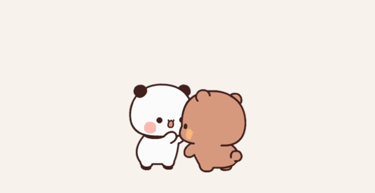

# 一二布布 · dsh-pet

让一二和布布住在桌面上。使用 **dsh-pet 原生角色包机制**，保留拖拽甩抛、屏幕漫游、点击反馈、碰撞和右键动作菜单。

**[下载最新体验包](https://github.com/solitarynew/yier-bubu-dsh-pet/releases/latest)** · [素材来源](SOURCE_REVIEW.md) · [素材声明](ASSET-NOTICE.md)

| 双人版：两个独立实例 | 组合版：一个同框实例 |
|---|---|
|  |  |
| 一二、布布分别活动、分别拖拽。 | 两只在同一段动画里，一起拖拽。 |

## 下载后怎么用

当前正式提供 **macOS 体验包**，已在 Apple Silicon Mac 验证。需要先安装 **[Node.js LTS](https://nodejs.org/)（22.12 或更新版本）**。

1. 在 [Releases](https://github.com/solitarynew/yier-bubu-dsh-pet/releases/latest) 下载 **Source code (zip)**，完整解压到一个固定目录。这个 ZIP 已包含全部成品动画和启动脚本。
2. 双击 **`一键安装启动.command`**。
3. 首次运行会安装固定版本的 dsh-pet、下载并校验 Electron，然后显示桌宠。所有日常操作都在桌宠右键菜单里，不会自动打开网页。以后双击同一个文件即可启动。

普通使用**不需要 Python、ffmpeg，也不需要先安装 DSH**。首次需要联网，Electron 下载可能需要几分钟。安装日志直接显示在终端；已有相应 Electron 时会复用。

如果系统未直接执行脚本，可以在「终端」进入解压目录运行：

```sh
bash install-and-start.sh
```

从 GitHub 的 `Code → Download ZIP` 下载源码也能使用相同步骤。源码 ZIP 带角色包成品，不需要重新生成动画。

## 两种启动模式

第一次默认 **双人版**。右键任意桌宠 →「启动模式」选择，桌宠会立即按新模式重载，并记住最后选择。

| 模式 | 实例数 | 画面与行为 |
|---|---:|---|
| 双人版 | 2 | 一二、布布各自显示，分别移动和拖拽。 |
| 组合版 | 1 | 一个实例播放两只同框的抱抱、亲亲、骑车等动画。 |

不再默认同时启动三个实例。组合版是预制的双人表情，并不是两个独立实例靠近后自动合体。

开发者可用 `npm start -- --review` 手动打开素材预览页；日常使用无需网页。

## 怎么玩、怎么退出

- 拖动桌宠：抓着走，快速松手可甩抛。
- 点击桌宠：触发比心、撒花等反馈。
- 右键 → 动作：按分类点播一次，结束后恢复原版随机活动；移动动作会带着角色一起移动。菜单只列实际素材，每段动画只出现一次，`✓` 标记打开菜单时的当前动作。
- 右键 → 启动模式：切换双人版 / 组合版，`✓` 标记当前模式。
- 右键 → 自动漫游：控制当前角色是否自动移动；不影响手动拖拽和点播。
- 右键 → 靠近互动：双人版专用，全局控制两只角色的靠近互动，`✓` 表示开启。
- 右键 → 退出全部桌宠：关闭本项目全部桌宠和本地服务。
- 双击 `停止一二布布.command`：关闭本项目全部桌宠和预览服务。

所有本地状态和日志放在项目的 `.runtime/`，不修改你原有的 `~/.dsh` 配置，也不会添加开机自启。移动项目目录前请先停止，移动后重新启动。

## 靠近互动

双人版默认开启。将一二、布布拖到相近高度，靠近并松开后稍等，两只会暂停漫游、朝向彼此，配合播放动作。当前有三组：

| 一二 | 布布 |
|---|---|
| 比心 | 撒花 |
| 围巾舞 | 看一二照片 |
| 跳绳 | 跳绳 |

这是两个独立角色的动作联动。组合版的抱抱、亲亲仍属于预制同框动画，靠近互动不会切换启动模式或合并窗口。

拖拽、甩抛、点击、打开右键菜单会优先接管角色。互动结束后恢复原版活动；持续挨着不会重复触发，需要先分开，并经过约 18 秒冷却。手动操作后留出约 8 秒再允许互动。关闭「靠近互动」会中止当前互动，两个角色恢复独立活动。开关重启后仍保留，与各自的「自动漫游」开关独立。

配置保存在 `.runtime/menu-settings.json`，全局 `interactionEnabled` 为 `true` / `false`；普通用户直接用右键菜单修改即可。

## 命令行

```sh
npm start                     # 首次安装后启动；后续使用上次选择，初次为双人版
npm run start:pair            # 双人版：两个独立实例
npm run start:duo             # 组合版：一个同框实例
npm run status
npm stop
```

安装完成后也可直接运行 `node scripts/runtime.mjs start --mode pair`，不重复安装。

## 角色包与框架的关系

本项目通过 npm 使用固定版本 **dsh-pet@0.3.7**。角色通过原生角色包接入；右键菜单与靠近互动是本项目新增的桌面扩展。启动脚本会对该固定版本的桌面加载入口、菜单构建和点击处理应用可重复的补丁，保留上游原文件。未改动宿主服务或拖拽、抛掷、移动的物理计算。

我们提供：49 组适配后的透明 WebM、一二/布布/双人三个角色包、一键安装启动、桌面右键控制、可开关的靠近互动和素材转换工具。拖拽、抛掷、漫游和碰撞由上游框架实现；动作菜单保留原版点播一次的播放语义。

已经安装 dsh-pet 的用户，也可以只把 `packs/` 下三份 `*-config.json` 和对应的 `*-animation/` 目录复制到自己的 `$DSH_HOME/dsh-pet/pet/`，按需设置配置中的 `display` 后重载。直接复制角色包不会附带本项目的模式切换页。

## 素材来源和效果边界

素材来自 [xiaojieshi-bot/YierPet](https://github.com/xiaojieshi-bot/YierPet) 表情帧序列：一二 24 组、布布 15 组、双人 11 组。排除一段自带道路场景的滑板车动画后，保留 **一二 23 + 布布 15 + 双人 11 = 49 组**。

保留源素材的 8 fps，没有用 AI 插帧或重新画动作。部分素材仍有轻微残影、低分辨率边缘和小标记；不同动作不是统一起止姿势，切换时可能跳变。独立模式不提供模型聊天、余额查询或 DSH 会话联动。

**代码许可与角色素材分开。** 本项目原创脚本采用 [MIT](LICENSE-CODE.md)；角色形象和动画不包含在该代码许可中，来源与授权证据边界见 [ASSET-NOTICE.md](ASSET-NOTICE.md)。本项目是非官方粉丝制作版本。

## 重新制作素材（仅开发者）

只有重建动画时需要 Python 3、Pillow、ffmpeg（含 libvpx-vp9）。

```sh
python3 scripts/fetch_sources.py  # 下载 sources.json 中固定 commit 的原始 PNG 帧
python3 -m pip install -r requirements.txt
python3 scripts/build_assets.py
python3 scripts/verify_assets.py
```

`assets-manifest.json` 记录每个源动作到成品的映射、时长、缩放参数和 SHA256。安装时会校验全部 WebM；素材检查脚本还会真实解码验证 alpha、尺寸、时长和配置引用。

## 项目结构

```text
packs/                 角色配置与 49 组透明动画
review/                模式切换页、动画预览、效果对比
scripts/               安装、运行、服务、素材转换与检查
third_party/           上游许可原文
sources.json           来源仓库与固定 commit
assets-manifest.json   成品文件映射与校验值
.runtime/              本机状态与日志，不进入仓库
```

致谢：[PC2005-cloud/dsh-pet](https://github.com/PC2005-cloud/dsh-pet) 提供运行框架；[xiaojieshi-bot/YierPet](https://github.com/xiaojieshi-bot/YierPet) 提供表情帧序列与原始素材整理。
